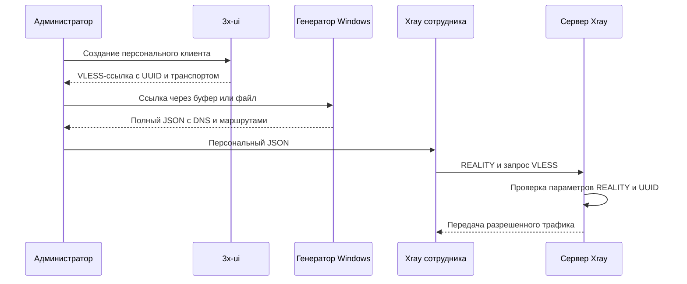
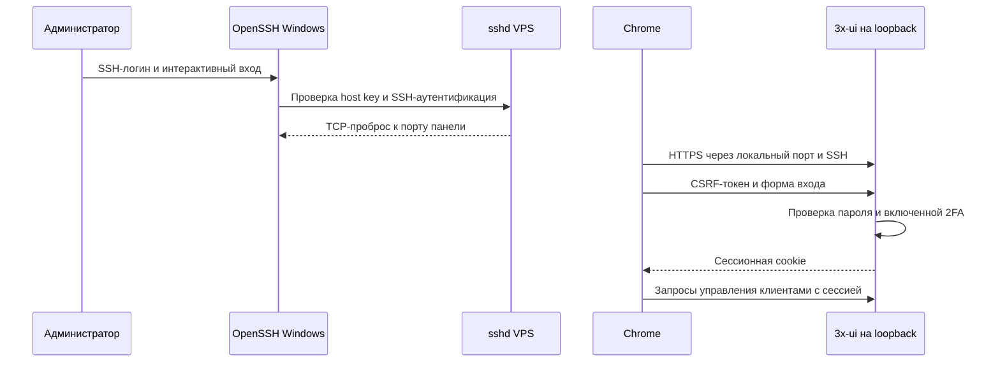

# Аутентификация VPN ПаркСказка

Этот репозиторий содержит скрипты и конфигурации инфраструктуры. Обработку VPN-соединений выполняет Xray, веб-вход обслуживает 3x-ui, SSH-вход обслуживает OpenSSH. Проверки приложения 3x-ui ниже сверены с исходниками тега `v3.11.0`. Фактический серверный Xray в аудите от 25 ноября имел версию `26.7.28`, проверенный клиент Windows — `26.11.9`.

| Компонент | Проверяемое удостоверение | Место проверки |
| --- | --- | --- |
| Локальный mixed-прокси | Доступ к loopback компьютера, `auth=noauth` | Xray на `127.0.0.1:10808` |
| VLESS | UUID сотрудника | Список разрешенных клиентов серверного inbound Xray |
| REALITY | Пара ключей, допустимый SNI и ShortID, параметры TLS | Клиент и сервер Xray |
| SSH | Ключ сервера, затем пароль или ключ SSH-пользователя | OpenSSH и конфигурация sshd |
| Веб-панель | Логин, пароль, TOTP при включенной 2FA | 3x-ui, затем сессионная cookie |
| API 3x-ui | Сессия или Bearer-токен с разрешенным scope | Контроллер API и сервис токенов upstream |

1. **Выдача профиля сотрудника**

Администратор создает клиента в 3x-ui и копирует персональную ссылку. `ConvertFrom-VlessLink` разбирает UUID, адрес, порт и параметры транспорта. Главный блок генератора присоединяет выход `proxy` к общему шаблону, выполняет доступную локальную проверку Xray и записывает JSON. Для ввода JSON сохраняется исходный VLESS-выход. Имя итогового файла не изменяет UUID. Панельный логин и API-токен генератору не передаются. [Код генератора](../tools/employee-profile-generator/New-EmployeeProfile.ps1)

VLESS проверяет UUID. В конфигурациях используется `encryption=none`, а защиту внешнего транспорта обеспечивает `streamSettings.security=reality`. Серверный `privateKey` и клиентский `publicKey`/`password` относятся к REALITY. Ключ, SNI и ShortID согласуются между сторонами. Запрос, не прошедший REALITY-аутентификацию, может быть передан на TLS-цель. Ответ целевого сайта на обычный HTTPS-запрос поэтому еще не проверяет UUID сотрудника. [VLESS](https://xtls.github.io/en/config/inbounds/vless.html), [REALITY и поведение клиента](https://github.com/XTLS/REALITY/blob/main/README.en.md)

2. **Доступ администратора к панели**

`Open-3xui.ps1` читает адрес и ожидаемый отпечаток из `admin.local.json`, запускает системный `ssh.exe` и ждет появления локального слушателя своего SSH-процесса. OpenSSH выполняет проверку ключа сервера через `known_hosts` с `StrictHostKeyChecking=ask`. Пароль и парольная фраза ключа вводятся в окно OpenSSH. Скрипт передает SSH-логин, параметры соединения и локального проброса. [Скрипт запуска](../tools/admin/Open-3xui.ps1)

В 3x-ui `IndexController` регистрирует `GET /csrf-token` и `POST /login`, передает форму в `UserService.CheckUser` и при успехе вызывает `session.SetLoginUser`. Проверка пароля выполняется через `crypto.CheckPasswordHash`. Встроенный лимитер считает неудачные входы. Включенные LDAP и TOTP добавляют проверки согласно настройкам. Состояние 2FA и LDAP на этом VPS по ноябрьскому аудиту не определялось. [Обработчик входа](https://github.com/MHSanaei/3x-ui/blob/v3.11.0/internal/web/controller/index.go), [проверка пользователя](https://github.com/MHSanaei/3x-ui/blob/v3.11.0/internal/web/service/panel/user.go)

Сессия хранит идентификатор пользователя и `LoginEpoch`. При последующих проверках 3x-ui загружает пользователя и сравнивает epoch. Выход очищает сессию. Cookies панели находятся в выделенном профиле Chrome администратора, который создает запускатель. Политику срока жизни определяют настройки панели и реализация сессий. [Код сессий](https://github.com/MHSanaei/3x-ui/blob/v3.11.0/internal/web/session/session.go)

3. **API-токены и другие токены**

Код `APIController.checkAPIAuth` upstream принимает `Authorization: Bearer ...` и проверяет его через `ApiTokenService.MatchToken`. Сервис хранит SHA-256 токена, проверяет включенность, известный scope и срок действия. Открытое значение возвращается при создании. API также допускает панельную сессию и предусмотренную upstream проверку mTLS для узлов. Репозиторные скрипты используют интерактивный SSH и персональный VLESS-профиль. Наличие созданных API-токенов на конкретном VPS требует отдельной проверки в панели. [Контроллер API](https://github.com/MHSanaei/3x-ui/blob/v3.11.0/internal/web/controller/api.go), [сервис токенов](https://github.com/MHSanaei/3x-ui/blob/v3.11.0/internal/web/service/panel/api_token.go)

CSRF-токен связан с защитой веб-запросов. Cookie панели подтверждает веб-сессию. UUID дает доступ через VLESS. Флаг ссылки `support-x25519mlkem768` передает совместимость REALITY для других клиентов. Эти значения имеют разные назначения. Имена HTTP-заголовков и значение XHTTP `xPaddingMethod=tokenish` описывают транспортные данные.

4. **Хранение и отзыв**

| Данные | Хранение и жизненный цикл |
| --- | --- |
| UUID сотрудника | В 3x-ui и открытом JSON/ссылке сотрудника. Удаление или отключение клиента отзывает доступ. Уже установленные соединения проверяются отдельно, завершение зависит от применения конфигурации и настройки рестарта. |
| Закрытый REALITY-ключ | На сервере в конфигурации и связанных резервных копиях. При замене пары обновляются клиентские ключи. |
| Ключ SSH-пользователя | На компьютере администратора или в агенте. На сервере разрешен соответствующий открытый ключ. Отзыв нового входа не завершает автоматически существующую SSH-сессию. |
| Пароль панели и 2FA | Обрабатываются сервером 3x-ui. Состояние меняется в панели, действующие сессии требуют проверки отзыва. |
| Cookie, Bearer, подписочная ссылка | Относятся к данным доступа. Репозиторий хранит шаблоны и ссылки на реализацию, рабочие значения находятся в локальном архиве или учетных системах. |
| Временные JSON генератора | Создаются рядом с результатом, удаляются при обработанной ошибке, результат переименовывается без перезаписи. Аварийное завершение процесса может оставить временный файл. |

В `local/` находятся исходные экспорты с манифестом. Папки `profiles/`, локальный файл администратора, ключевые файлы и журналы исключены через `.gitignore`. Файл `.gitignore` действует на новые добавления. Перед публикацией проверяется содержимое Git-индекса. Для копирования репозитория целиком локальный архив требует отдельного контроля доступа и резервного хранения. [Правила исключения](../.gitignore), [код аудита с ограничением вывода](../tools/audit-reality.py)
